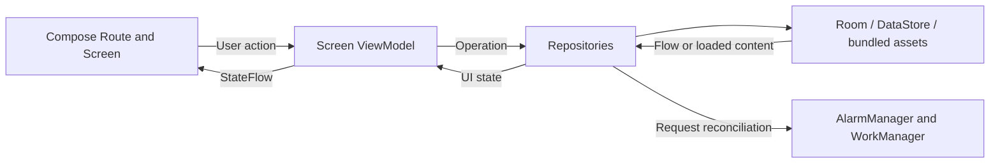

<div align="center">
  
  <h1>PawCare</h1>
  <p>A local Android companion for everyday dog care.</p>
  <p>Plan routines, keep care history, and organize each dog's records in one place.</p>
  <p>
    
    
    
    
    
  </p>
</div>

## Demo

**YouTube demo: [▶ Watch the demo on YouTube](https://youtu.be/soR6AOx2jcg)**

## Overview

PawCare is a personal Android project for dog owners who want a clear view of upcoming care and a lasting record of what has been done. It brings together schedules, weight measurements, documents, and useful contacts for multiple dogs.

The app starts with an empty user database. Records stay on the device, and the core experience requires no account, backend, or internet connection. A built-in Discover section offers illustrated reading about everyday dog care.

## Key Features

| Area | Implemented behavior |
| --- | --- |
| Dog profiles | Add, edit, select, and delete dogs; store an optional photo, breed, sex, birthday or approximate birthday, microchip number, and notes. |
| Today | Review overdue care, today's events, and the next seven days for one dog or all dogs; open completion and rescheduling actions. |
| Calendar | Browse months, see event markers, select a day, and filter by dog or category. The first weekday follows the selected locale. |
| Care planning | Schedule treatments, vaccinations, grooming, vet visits, and other care. Choose a one-time event, a fixed interval, or an interval measured from actual completion; use days, weeks, or calendar months. |
| Event lifecycle | Complete care with an actual date, time, and comment; reschedule, skip, cancel, edit one event or a future series, and archive recurring plans. Add past care from History. |
| History | Browse completed and skipped care by category. Completion records retain the title, category, notes, and medication captured at completion; edit the actual date or comment, or undo completion subject to history safeguards. |
| Weight | Add, edit, and delete dated measurements with notes; view a custom line chart. Decimal commas and decimal points are accepted. |
| Documents | Import PDFs and photos, preview images, open PDFs externally, rename, share, and delete files. Attach photos to care events and completed care; find them in the dog's document collection. |
| Contacts | Save vets, clinics, groomers, and other contacts; open the phone dialer and copy an address. |
| Reminders | Configure same-day and advance notifications, a default time for untimed events, and a global notification switch. Tapping a notification opens the relevant event. |
| Discover | Read six bundled articles with illustrations, selectable text, tips, and external source links. Today's featured article opens the same reader. |
| Languages | Switch between English, Russian, Ukrainian, Polish, and the system language. UI resources and article content are localized. |

The Compose UI uses a light palette with forest-green and warm neutral accents. Startup waits for the database and preferences, with an animated progress bar and a retry state on failure; the bar is a presentation animation rather than a measured loading percentage.

## Screenshots

<!-- No application screenshots are currently included. Add real captures of Today with care events, the filtered Calendar, care recurrence settings, a dog profile, weight history, and the Discover reader. Use repository-relative image paths after the files exist. Article artwork is content imagery, not a screenshot of the app. -->

## Tech Stack

Versions below describe the checked-in configuration, not claims about the latest releases. The complete dependency catalog is in [gradle/libs.versions.toml](gradle/libs.versions.toml).

| Technology | Purpose in this project |
| --- | --- |
| Kotlin 2.4.21 / Java 17 bytecode | Application code, domain models, recurrence rules, and coroutine-based operations. The Gradle daemon uses JDK 21. |
| Jetpack Compose / Material 3 | Screens, forms, navigation bar, dialogs, theme, and a Canvas-based weight chart. Compose libraries are coordinated by BOM `2026.09.00`. |
| AndroidX Lifecycle 2.11.0 / Coroutines 1.11.0 | Screen ViewModels expose UI state through StateFlow. Routes collect with `collectAsStateWithLifecycle()`; Flow combines stored records, preferences, and time updates. |
| SavedStateHandle / Compose saveable state | Restore form fields, filters, selected tabs, and screen state through supported recreation paths. Operation results remain in state until acknowledged. |
| Navigation 3 1.2.0 / Kotlin Serialization 1.12.0 | Serializable destination keys, a saveable back stack, and navigation-entry ViewModel stores. Serialization is used for navigation keys; article JSON is parsed with `org.json`. |
| Room 2.8.5 | Persist dogs, care plans, occurrences, completion records, weights, contacts, attachment metadata, and reminder delivery state. Transactions coordinate related care changes. |
| Preferences DataStore 1.3.0 | Persist the active dog, onboarding flag, notification switch, and default reminder time. |
| Hilt 2.60.1 / AndroidX Hilt 1.4.0 / KSP 2.3.12 | Inject repositories, Room, time sources, file storage, ViewModels, and WorkManager workers; generate Room and Hilt code. |
| AlarmManager / WorkManager 2.12.0 | Schedule inexact local alarms, reconcile upcoming reminders, deliver notifications after rechecking stored state, and clean up orphaned files. |
| Photo Picker / Storage Access Framework / FileProvider | Let users select images and PDFs, copy them into private storage, and grant temporary read access for opening or sharing. |
| Coil 3.6.3 / ExifInterface 1.4.2 | Display local pet photos and attachments; normalize photo orientation and mirroring during import. No Coil network module is configured. |
| AppCompat 1.8.0 | Apply and persist per-app language selection. The activity hosts a Compose UI. |
| `java.time` / injected Clock and zone source | Calculate calendar recurrence, overdue status, actual completion instants, and reminders using the device's current time zone. |
| Gradle Kotlin DSL / AGP 9.4.1 / Gradle Wrapper 9.6.0 | Configure the single application module, pinned dependencies, Compose, and generated code. |

**Networking:** there is no application network layer, API client, authentication, analytics, or cloud sync. The main manifest does not request `INTERNET`. Article source links open in an external browser. Existing JUnit, Espresso, and Compose test dependencies accompany template tests; they do not establish feature coverage.

## Architecture

The implementation follows **MVVM with repository-backed, unidirectional state flow**, organized by feature inside one `:app` module.

- **Routes** collect ViewModel state and connect screen callbacks, navigation, and Android activity-result APIs.
- **Screens** render state and emit callbacks. Shared components live in `core/ui`; several screens have Compose previews with isolated sample data.
- **ViewModels** combine repository flows into screen state, validate and submit form operations, and track busy, error, and acknowledged-save states.
- **Domain code** defines models, repository contracts, and recurrence calculations without Room or Compose dependencies.
- **Data implementations** persist records and preferences. Platform adapters handle files, notifications, clocks, and time zones. Hilt connects these pieces.



Care plans, scheduled occurrences, and completion records are distinct models. This lets the app move one event without changing a whole series, preserve completion snapshots, and calculate completion-based recurrence from what actually happened.

## Project Structure

Paths under `app/src/main/java/com/example/pawcare/`:

```text
app/                  Typed destinations, Navigation 3 host, and home tabs
feature/              Today, calendar, care, pet, records, articles, settings, startup
  <feature>/          Routes, screens, ViewModels, and UI state
domain/              Models, repository contracts, and recurrence calculations
data/                Room entities/DAO, repositories, and DataStore preferences
core/                Shared UI, file handling, notifications, and time adapters
di/                  Hilt bindings and providers
ui/theme/            Material color, typography, and shape definitions
```

Additional project resources:

- `app/src/main/assets/articles/` — four localized JSON article collections.
- `app/src/main/res/` — UI translations, icons, article WebP images, and Android resource configuration.
- `app/schemas/` — exported Room schema, currently version 1.
- `gradle/` — version catalog, wrapper, and daemon JVM criteria.
- `docs/` — stack decisions, historical verification notes, and article documentation.
- `artwork/articles/` — generated article image sources, earlier vectors, and generation/export provenance.

## Getting Started

### Requirements

| Requirement | Project configuration |
| --- | --- |
| Android Studio | The existing setup notes record Rabbit 1 (`2026.2.1`). Use an IDE compatible with the pinned AGP 9.4.1 configuration. |
| Gradle JVM | JDK 21, selected by `gradle/gradle-daemon-jvm.properties`. Java/Kotlin compilation targets JVM 17. |
| Android SDK | Compile and target API 37. Existing setup notes record Build Tools `36.0.0`; the module does not pin `buildToolsVersion`. |
| Run destination | Android 8.0 / API 26 or later, as declared by `minSdk`. This is a configuration requirement, not a device validation matrix. |

See [Android stack decisions](docs/android-stack.md) for the recorded setup and compatibility rationale.

### Open and run

1. Download the project and open its root directory in Android Studio.
2. Configure an installed JDK 21 and the Android SDK location through the IDE. If needed, set `sdk.dir` in your local `local.properties`; do not copy another machine's path.
3. Sync Gradle. The wrapper and configured Google/Maven repositories resolve dependencies; the initial setup needs internet access.
4. Select the `app` configuration and an existing compatible emulator or connected Android device, then Run. Allow notifications when prompted if you want reminders.

No API keys, backend credentials, or external service setup are required.

To compile a debug APK and run Android Lint from the project root:

```sh
./gradlew :app:assembleDebug :app:lintDebug
```

Outputs after a successful run:

- APK: `app/build/outputs/apk/debug/app-debug.apk`
- Lint report: `app/build/reports/lint-results-debug.html`

Optional installation onto a connected device with USB debugging enabled:

```sh
adb install -r app/build/outputs/apk/debug/app-debug.apk
```

These are build and static-analysis commands, not automated feature tests. No build, lint, tests, or device checks were run for this documentation update. Earlier development records remain in [docs/verification.md](docs/verification.md); they are historical evidence, not a fresh verification of this checkout.

## Technical Highlights

1. **Two explicit recurrence strategies.** Fixed schedules calculate every date from the original anchor, preserving month-end intent: January 31 → February's last day → March 31. Completion-based schedules create the next occurrence from the actual completion date in the same transaction as the completion record.
2. **History protected from later edits.** Completion records snapshot care details. Unique database indices prevent duplicate occurrences for a plan/date and duplicate completions for an occurrence. Undo and date changes refuse to rewrite already processed downstream history.
3. **Reminder reconciliation against current data.** A persisted reminder registry and delivery-time checks reject outdated triggers after changes to an event. Reconciliation responds to data changes, app opening, reboot, clock/time-zone changes, and app updates.
4. **Private file imports with bounded processing.** Imports enforce a 20 MiB input limit and check file type, including the PDF header. Photos are downsampled, corrected using EXIF, and stored as JPEG; Room keeps metadata rather than image or PDF bytes. FileProvider limits sharing to the media directory.
5. **A structured offline reader.** The article repository reads and caches language-specific bundled content on an IO dispatcher. Native Compose text renders headings, emphasis, lists, callouts, illustrations, and source links without a WebView. Unsupported languages fall back to English.

<details>
<summary>Scheduling, time, and storage details</summary>

### Care dates

Fixed schedules materialize a rolling 90-day window and the nearest occurrence beyond it; browsing another calendar month requests that month's dates. Long absences do not generate every missed date from previous years, while already stored overdue occurrences remain pending. Late completion does not shift the fixed anchor or complete other overdue events.

Completion-based plans normally hold one pending occurrence. Skipping requires an explicit next date. Undoing completion removes only pending successors; processed successors protect the history. Editing a future series recreates pending occurrences from the chosen original date and preserves past records. Attachments of removed future occurrences remain in the dog's documents with their event link cleared.

Dates and optional event times are stored as local values; actual completion times are stored as epoch-millisecond instants. Untimed events become overdue the next day, timed events after their specified time. Untimed reminders default to the configurable 09:00. Time-zone calculations use the device's current zone; DST gaps and overlaps follow Java's `LocalDateTime.atZone()` behavior.

### Notification window

AlarmManager uses `setAndAllowWhileIdle`, without exact-alarm permission. At most 64 alarms are scheduled within the next 14 days. A unique periodic WorkManager job reconciles the window every 12 hours, with additional reconciliation requests after relevant changes. Delivery workers recheck event status, settings, trigger time, permission, and delivery state; old notifications are not replayed in bulk.

### Local data lifecycle

Room schema version 1 is exported and no destructive-migration fallback is configured. Future schema changes require explicit migrations. User-created records are not seeded with preview samples.

Files live in private internal storage. Failed imports remove temporary files; record deletion cleans up associated files. Reconciliation removes unreferenced media older than a day, including files left by interrupted forms. Sharing uses temporary read grants. Broad storage and direct phone-call permissions are not requested.

Automatic backup and device transfer are explicitly excluded. Uninstalling the app removes local records and files; there is no cloud restoration or full database export/import flow.

</details>

## Limitations and Verification

- Reminders are inexact and Android may delay delivery. Notification permission and channel settings affect delivery; force-stopping the app prevents background work until it is opened again.
- Data stays on one installation. There is no account, cloud synchronization, or app-level backup/restore. PDF viewing requires an external compatible viewer.
- The interface currently uses a light theme. The app records user-entered care and weight; it does not calculate treatments, dosages, or medical assessments.
- Existing automated tests are template arithmetic and package-name checks. They do not validate the care workflows. Full device acceptance remains incomplete, including recurrence transitions, file operations, notification delivery, and lifecycle/permission behavior.

<details>
<summary>Manual acceptance checklist</summary>

1. Create two dogs; check optional photos, long names, non-Latin text, selection, editing, and deletion.
2. Exercise all three scheduling modes, month-end dates, backdated completion, rescheduling, skipping, undo, and future-series editing; compare Calendar and History.
3. Restart and rotate the app; restore interrupted forms after process recreation, and inspect large-text and keyboard layouts.
4. Allow and deny notifications; check real delivery, event opening from a notification, reboot, and time-zone changes.
5. Exercise weight/contact editing and deletion; import, preview, open, share, rename, and delete images/PDFs; try invalid files and a device without a PDF viewer.
6. Switch all four supported languages; inspect calendar locale, article content, scrolling, and system notification settings.

</details>

## Further Documentation

- [Android stack and compatibility decisions](docs/android-stack.md)
- [Historical build and manual verification notes](docs/verification.md)
- [Offline articles and localization](docs/articles.md)
- [Article artwork and provenance](artwork/articles/README.md)
- [Article image briefs](docs/article-image-briefs-ru.txt)

These existing supporting documents are in Russian and include dated development history.
